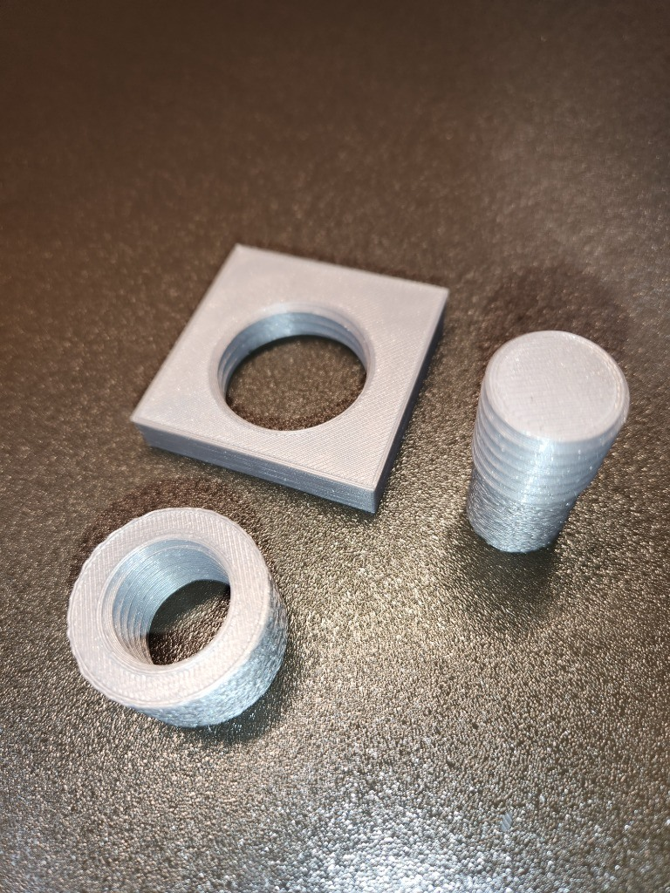
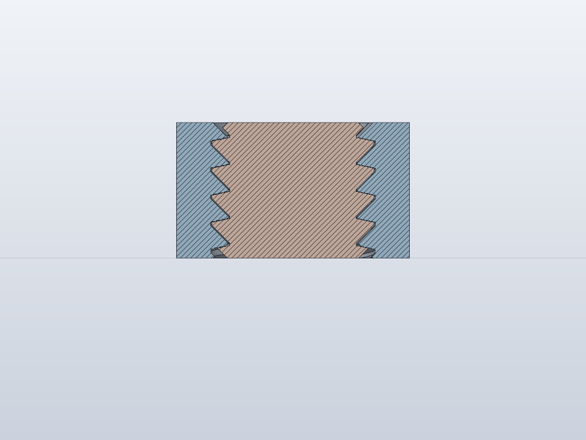
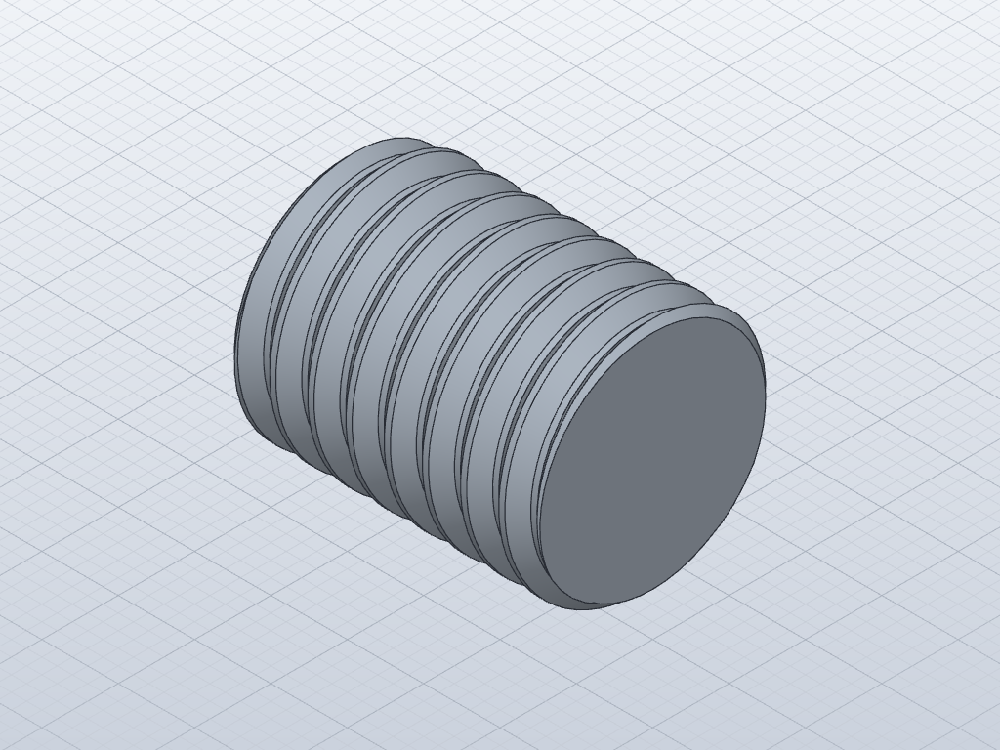

# SolidCraft Custom Threads (`custom-threads`)

SolidCraft plugin for smooth, exact B-rep custom threads with arbitrary sizes, flank angles, clearances, multi-start leads, collapsed timeline folders, and live parameters.

Instead of generating heavy faceted triangle meshes in plugin code, **Custom Threads** constructs a constrained 2D trapezoidal or buttress groove profile and sweeps it via SolidCraft's exact helical B-rep engine (`solid.coil`). Models stay true analytic/NURBS B-rep in SolidCraft, export cleanly to STEP/3MF/STL with fewer triangles than standard threaded meshes, and update live when edited in SolidCraft's **Parameters** dialog or **Edit Thread**.

<p align="center">
  
</p>
<p align="center">
  <em>Actual 3D-printed test parts (external shaft, mating nut, and threaded plate bore) generated with Custom Threads.</em>
</p>

---

## Gallery

| 45° FDM Bolt + Nut Pair | Coaxial 45° Clearance Section |
| :---: | :---: |
|  |  |
| **Asymmetric `12°/45°` 2-Start Left-Hand Buttress** | **Off-Axis Shaft Threading (`+X`)** |
|  |  |

---

## Key Features

- **Exact B-rep Coils (`solid.coil`):** Clean, smooth STL/3MF/STEP exports with independent upper & lower flank angles (`1°–80°`) — `45°/45°` for support-free FDM printing, `30°/30°` for ISO 60°, or asymmetric angles (`10°/45°`, `12°/45°`) for buttress threads.
- **Tunable Clearances & Nozzle Flats:** Built-in per-side `radial_clearance` (`solid.offset_face` on bores or optionally on shafts), `axial_clearance` groove widening, nozzle-friendly `crest_flat` / `root_flat` widths, optional corner fillets, and revolved `45°` lead-in/lead-out end chamfers (`min(0.95 * depth, 0.25 * length)`).
- **Auto-Detect External vs. Internal Faces:** **Apply Thread** detects external shafts vs. internal holes automatically (`mode: "auto"`), handles arbitrary axis directions and blind holes (chamfering free ends only), and avoids naming collisions across multiple threaded parts.
- **Multi-Start Quick-Spin Threads (`1..8` starts):** Interleaved helical tracks (`lead = starts × pitch`) plus `left_hand` support.
- **Collapsed Timeline Folders (`timeline.group`):** Collapses each thread's features into one named timeline folder (and nests `Bolt <prefix>` + `Nut <prefix>` subfolders inside `Thread Pair <prefix>`).
- **Ordered Live Parameters & In-Place Editing:** Creates favorited User Parameters in dialog order (`<p>_major_d`, `<p>_pitch`, `<p>_length`, `<p>_starts`, angles, clearances, flats, fillets, nut wall, spacing) that rebuild the 3D B-rep live, paired with **Edit Thread** for live-previewed updates including `Left-Hand Thread` and `End Chamfer`.

---

## Benchmark vs. Built-in `solid.thread` (`20 mm × 20 mm` M20)

| Output Metric | Custom Threads (`45°/45°`) | Built-in M20 `solid.thread` |
| --- | ---: | ---: |
| Standard STL Triangles | **17,726** (`886 KB`) | 33,440 (`1.67 MB`) |
| Fine STL Triangles | **69,360** (`3.47 MB`) | 72,784 (`3.64 MB`) |
| Coaxial B-rep Interference | **0 intersections** | — |

*(B-rep pair also exports cleanly to `543 KB` `.3mf` and `623 KB` `.step`.)*

---

## Installation (SolidCraft `0.44.1`+)

1. Download **`custom-threads.zip`** from the [Latest GitHub Release](https://github.com/Sooner4500/solidcraft-custom-threads/releases/latest) (no Rust toolchain required).
2. In SolidCraft, open **File ▸ Plugins… → Install plugin…** and select `custom-threads.zip`.
3. Review permissions (`commands@0.1`, `files: []`, `net: false`, `clock: false` — zero external/network permissions) and confirm.
4. Three commands appear in the **Model** tab's **Plugins** menu/group:
   - **Apply Thread** (`apply-thread`) — Thread an existing cylindrical shaft or hole face.
   - **Thread Pair** (`create-thread-pair`) — Generate a standalone Bolt + Nut (or Bolt / Nut) test pair.
   - **Edit Thread** (`edit-thread`) — Modify an existing thread's parameters, helical hand, or chamfers with live viewport preview.

---

## Commands & Parameters

### 1. `apply-thread`

Pick a cylindrical shaft or bore face (or pre-select one before clicking) to cut helical threads along its axis.

| Parameter | Default | Description |
| --- | --- | --- |
| `face` | *(selected)* | Cylindrical shaft or hole face (`x-solidcraft-selection`). Optional if already selected. |
| `mode` | `auto` | `auto` (detect shaft vs. hole), `external` (shaft), or `internal` (hole). |
| `param_prefix` | *(auto `t1`, `t2`…)* | Optional custom User Parameter prefix (`[A-Za-z][A-Za-z0-9_]*`). |
| `pitch` | `3.0` | Axial distance between adjacent thread crests (mm). |
| `length` | *(full span)* | Threaded length along axis (`0` or blank threads the entire face). |
| `starts` | `1` | Number of thread starts (`1..8`; `lead = starts × pitch`). |
| `left_hand` | `false` | Reverse helical twist direction when `true`. |
| `upper_flank_angle_deg` | `45.0` | Upper flank angle from horizontal (`45°` prints support-free; `30°` matches ISO 60°). |
| `lower_flank_angle_deg` | `45.0` | Lower flank angle from horizontal (vary independently for buttress profiles). |
| `radial_clearance` | `0.2` | Per-side radial clearance applied on internal bores (or external if enabled). |
| `axial_clearance` | `0.1` | Extra axial groove widening (mm) for smooth engagement. |
| `crest_flat` | `0.4` | Flat width at tooth crest (mm; keep ≥ nozzle width for durable teeth). |
| `root_flat` | `0.4` | Flat width at tooth root (mm). |
| `crest_fillet` | `0.0` | Optional corner fillet radius on crests (`0` disables). |
| `root_fillet` | `0.0` | Optional corner fillet radius on roots (`0` disables). |
| `end_chamfer` | `both` | Revolved `45°` lead-in/lead-out chamfer on free ends (`both`, `start`, or `none`). |
| `apply_clearance_to_external` | `false` | When `true` on an external shaft, applies radial & axial clearance to the shaft directly. |

### 2. `create-thread-pair`

Generates a mating **Bolt**, **Nut**, or **Bolt + Nut** pair aligned along Z. Uses the same profile, flank-angle, clearance, fillet, and chamfer options above, plus:

| Parameter | Default | Description |
| --- | --- | --- |
| `generate` | `pair` | `pair` (Bolt + Nut), `bolt`, or `nut`. |
| `param_prefix` | *(auto `t1`, `t2`…)* | Optional custom User Parameter prefix (`[A-Za-z][A-Za-z0-9_]*`). |
| `major_diameter` | `20.0` | Nominal outer thread diameter (mm). |
| `length` | `20.0` | Threaded cylinder height along Z (mm). |
| `nut_wall_thickness` | `5.0` | Radial wall thickness outside the nut's thread major radius (mm). |
| `pair_spacing` | `10.0` | Gap between Bolt and Nut when generating both (mm). |

### 3. `edit-thread`

Updates an existing Custom Thread in place. Select any face/body of the thread, type its `param_prefix`, or leave both blank to target the sole/latest thread. Because SolidCraft plugin dialogs start empty without querying the model on open, leave fields blank to keep their current values — SolidCraft's **Preview** toggle updates the viewport live as you type.

- Numeric & angle fields apply atomically via `parameters.change`.
- `left_hand` (`keep`, `right`, `left`) edits coils via `timeline.edit`.
- `end_chamfer` (`keep`, `both`, `none`) toggles revolved chamfers via `timeline.suppress`.
- Corner fillets (`crest_fillet` / `root_fillet`) alter sketch arc topology and can only be tuned live if enabled (`> 0`) at creation.

---

## Building from Source

Requires Rust (`wasm32-unknown-unknown` target) and [`wasm-tools`](https://github.com/bytecodealliance/wasm-tools):

```powershell
# Run unit & manifest validation tests
cargo test --offline

# Generate standalone SolidCraft CLI preview scripts in target/preview/
cargo run --offline --bin preview

# Build dist/custom-threads.zip and validate with wasm-tools + solidcraft-cli
powershell -ExecutionPolicy Bypass -File scripts/package.ps1
```

### Project Layout

- `plugin.json` — SolidCraft `commands@0.1` plugin manifest and JSON Schema inputs.
- `wit/plugin.wit` — Official SolidCraft `v0.44.1` WIT contract (`craft:plugin@0.1.0`).
- `assets/*.svg` — Monochrome `64×64` ribbon/menu icons (`apply-thread`, `thread-pair`, `edit-thread`).
- `src/math.rs` — Trapezoidal/buttress groove solver, tangent-trim fillet checks, buttress phase alignment, orthonormal frame builder, and cylinder/mesh classification.
- `src/commands.rs` — Expression-driven 0-DOF sketch, User Parameter, coil, visibility, circular pattern, chamfer, and metadata builders.
- `src/lib.rs` — Wasm `command-plugin` entry points (`apply-thread`, `create-thread-pair`, `edit-thread`) and unit tests.
- `scripts/package.ps1` — Windows release packager & validator.
- `.github/workflows/release.yml` — Automated CI tests & `v*` tag release builder.

---

## License

[MIT](LICENSE) © 2026 Sooner4500
