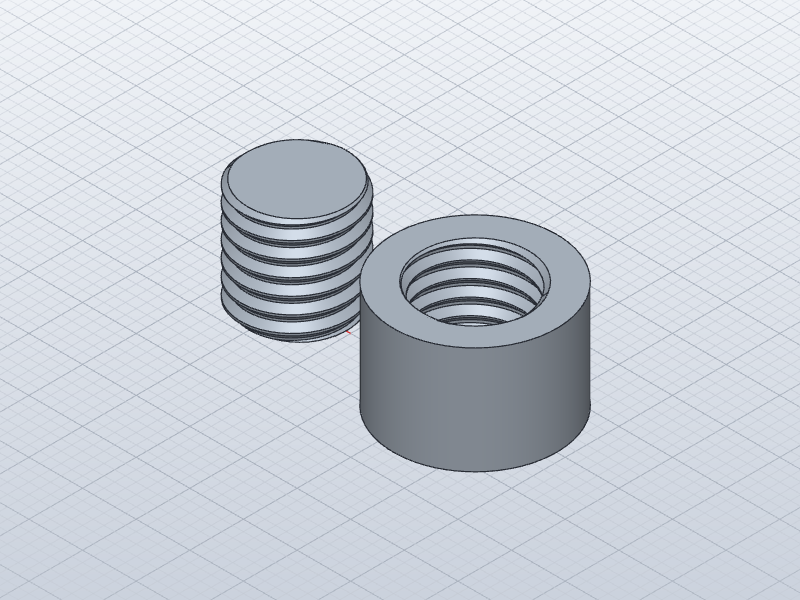
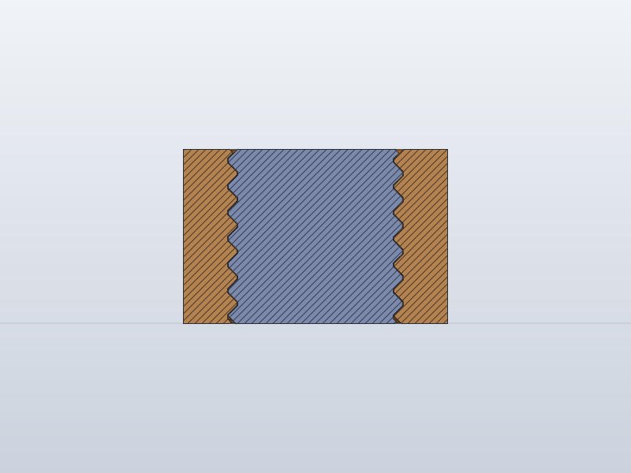

# SolidCraft Custom Threads (`custom-threads`)

SolidCraft plugin for smooth, exact B-rep custom threads with arbitrary sizes, flank angles, clearances, multi-start leads, collapsed timeline folders, and live parameters.

Designing threads for 3D printing—or for parts outside standard metal fastener tables—is usually a chore. Standard CAD thread tools follow machined-metal specs with near-zero clearance and steep 60° overhangs that often droop, bind, or fuse straight off an FDM printer. **Custom Threads** lets you add printable, custom-sized threads to any cylindrical shaft or hole in SolidCraft, with built-in clearances, self-supporting overhang angles, and live parameters you can dial in after a quick test print.

<p align="center">
  
</p>
<p align="center">
  <em>Actual 3D-printed test parts (external shaft, mating nut, and threaded plate bore) generated with Custom Threads.</em>
</p>

## Why Custom Threads?

- **Threads that actually screw together off the build plate:** Built-in **radial clearance** (`0.2 mm` default) and **axial backlash** (`0.1 mm` default), support-free **45° flank angles**, nozzle-friendly **flat crests and roots** (`0.4 mm` default), and **45° lead-in chamfers** so printed bolts, caps, and threaded holes start easily and spin smoothly without sanding or chasing with a tap.
- **Dial in your printer's fit in seconds:** Printers, filaments, and nozzle sizes vary. Every thread creates ordered **Parameters** (and works with **Edit Thread** live preview), so if a test print feels slightly tight, you can bump radial clearance from `0.2 mm` to `0.25 mm` and re-export—no redoing sketches or hunting through timeline steps.
- **Any diameter, pitch, or profile — not just standard tables:** Go beyond built-in M-series fastener charts. Thread custom enclosures, jar lids, adapters, left-hand shafts, or load-bearing asymmetric **buttress** threads (`12°/45°`, etc.) on any shaft or bore at any orientation—or generate a standalone **Bolt + Nut** test pair to verify clearance before printing a large part.
- **Quick-spin multi-start caps (`1–8` starts):** Create water-bottle-style multi-track threads so caps and containers catch effortlessly and tighten in a fraction of a turn instead of searching for alignment.
- **Smooth B-rep geometry & tidy timelines:** Rather than generating heavy faceted meshes, Custom Threads sweeps a constrained 2D groove profile through SolidCraft's native helical B-rep engine (`solid.coil`). Models stay true analytic/NURBS B-rep, export cleanly to STL, 3MF, and STEP with fewer triangles, and collapse into a single named timeline folder.

---

## Gallery

| 45° FDM Bolt + Nut Pair | Coaxial 45° Clearance Section |
| :---: | :---: |
|  |  |
| **Asymmetric `12°/45°` 2-Start Left-Hand Buttress** | **Off-Axis Shaft Threading (`+X`)** |
|  |  |

---

## Technical Highlights

- **Exact B-rep Coils (`solid.coil`):** Clean, smooth STL/3MF/STEP exports with independent upper & lower flank angles (`1°–80°`) — `45°/45°` for support-free FDM printing, `30°/30°` for ISO 60°, or asymmetric angles (`10°/45°`, `12°/45°`) for buttress threads.
- **Tunable Clearances & Nozzle Flats:** Built-in per-side `radial_clearance` (`solid.offset_face` on bores or optionally on shafts), `axial_clearance` groove widening, nozzle-friendly `crest_flat` / `root_flat` widths, optional corner fillets, and revolved `45°` lead-in/lead-out end chamfers (`Regular` `0.95×` depth, `Wide` `1.5×` depth, or custom `mm`).
- **Auto-Detect External vs. Internal Faces & Smart Sizing:** Automatically detects external shafts vs. internal holes (`opt_output: "auto"`), resizes picked cylinders cleanly to matched presets or nominal hole major diameters, handles blind holes (chamfering free ends only), and falls back to standalone **Bolt + Nut** pairs when nothing is picked.
- **Multi-Start Quick-Spin Threads (`1..8` starts):** Interleaved helical tracks (`lead = starts × pitch`) plus `left_hand` support.
- **Self-Documenting Collapsed Timeline Folders (`timeline.group`):** Collapses each thread into one named timeline folder showing its active spec (`Garden Hose 3/4" GHT · 30°/30° · R0.20 A0.10 [t1]`), nesting `Bolt <prefix>` + `Nut <prefix>` subfolders inside standalone pairs.
- **Ordered Live Parameters & In-Place Editing:** Creates favorited User Parameters in dialog order (`<p>_major_d`, `<p>_pitch`, `<p>_length`, `<p>_starts`, angles, clearances, flats, fillets, nut wall, spacing) that rebuild the 3D B-rep live, paired with **Edit Thread** for live-previewed updates including `Left-Hand Thread` and `End Chamfer`.

---

## Benchmark vs. Built-in `solid.thread` (`20 mm × 20 mm` M20)

| Output Metric | Custom Threads (`45°/45°`) | Built-in M20 `solid.thread` |
| --- | ---: | ---: |
| Standard STL Triangles | **17,726** (`886 KB`) | 33,440 (`1.67 MB`) |
| Fine STL Triangles | **69,360** (`3.47 MB`) | 72,784 (`3.64 MB`) |
| Coaxial B-rep Interference | **0 intersections** | — |

*(B-rep pair also exports cleanly to `543 KB` `.3mf` and `623 KB` `.step`.)*

---

## Installation (SolidCraft `0.44.1`+)

1. Download **`custom-threads.zip`** from the [Latest GitHub Release](https://github.com/Sooner4500/solidcraft-custom-threads/releases/latest) (no Rust toolchain required).
2. In SolidCraft, open **File ▸ Plugins… → Install plugin…** and select `custom-threads.zip`.
3. Review permissions (`commands@0.1`, `files: []`, `net: false`, `clock: false` — zero external/network permissions) and confirm.
4. All four commands appear directly as icon buttons inside the **Model** tab's **Plugins** group (and its dropdown menu, plus SolidCraft `0.45+` AI/MCP plugin tools):
   - **Preset Thread** (`preset-thread`) — Pick from **35 built-in presets** (Garden Hose, Soda Bottles, Mason Jars, Tire Valves, Camera Tripods/Filters, Metric M5–M24, US UNC, Pipes, IBC S60×6, Cable Glands, plus `Auto-match face`) with optional 3D-print Fit & Nozzle adjustments.
   - **Custom Thread** (`custom-thread`) — Arbitrary diameter, pitch, length, and `1–8` starts with beginner-friendly **Tight / Regular / Wide / None** Fit, Nozzle/Layer scaling, and **Regular / Wide** chamfers.
   - **Advanced Thread** (`advanced-thread`) — Direct raw numeric control (independent upper/lower flank angles, radial/axial clearances, crest/root flats & fillets, custom mm chamfer, nut wall, spacing, prefix).
   - **Edit Thread** (`edit-thread`) — Update any existing thread in place (including `v0.2.0` designs) with live viewport preview and updated Timeline folder readouts.

> [!TIP]
> On **Preset Thread**, **Custom Thread**, and **Advanced Thread**, pick a cylindrical shaft/hole face to thread an existing part directly—or leave **Cylindrical Face** blank to generate a standalone **Bolt + Nut** test pair!

---

## Commands & Presets (`v0.3.0`)

### 1. `preset-thread` — Standard Threads with 3D-Print Clearance

Pick a preset and optionally check **3D Print Adjustments** (on by default):

- **Keeps True Mating Flanks:** Standard presets preserve their real flank angles (`60°` ISO/UNC/GHT, `55°` BSPP, `80°` PG, `10°/45°` & `30°/45°` buttress/bottle, `29°` ACME) so printed parts mate cleanly with metal or factory hardware.
- **Fit Tiers (at `0.4 mm` nozzle / `0.2 mm` layer):** `Tight` (`0.12 / 0.06 mm`), `Regular` (`0.20 / 0.10 mm`, default), `Wide` (`0.32 / 0.16 mm`), or `None` (`0.00 mm`), scaled gently for nozzle width and layer height while clamping fine-thread flats (`≤ 0.25 × pitch`) so delicate threads never disappear.
- **Auto-Resize Picked Cylinders:** Pick either a nominal hole (e.g. `Ø8.0 mm` for `M8`) or a tap-drill hole (`Ø6.75 mm` for `M8`) — `Preset Thread` automatically resizes the face to the standard thread bore/major diameter with a safety check against severe mismatches.

| Category | Included Presets (with Everyday Dropdown Names) |
| --- | --- |
| **Auto-Match** | `Metric — Auto-match face` (`M3×0.5`–`M64×6.0`), `US Inch — Auto-match face` (`#10-24`–`1"-8 UNC`) |
| **Everyday, Bottles & Valves** | `Garden Hose — US 3/4" GHT`, `Soda / Water Bottle — PCO-1881` (28 mm), `Mason Jar Regular — 70G`, `Mason Jar Wide — 86G`, `Broom / Paint Pole — 3/4"-5 ACME`, `Tire Valve Cap — Schrader 8V1`, `Bike Valve — Presta 5V2` |
| **Metric Bolts & Nuts (`60°`)** | `M5×0.8`, `M6×1.0`, `M8×1.25`, `M10×1.5`, `M12×1.75`, `M16×2.0`, `M20×2.5`, `M24×3.0` |
| **US UNC & Tripods (`60°`)** | `1/4"-20` *(Camera Tripod)*, `5/16"-18`, `3/8"-16` *(Heavy Tripod)*, `1/2"-13`, `5/8"-11`, `3/4"-10` |
| **Plumbing, Tanks & Glands** | `1/2"` & `3/4" NPSM`, `G 1/2"` & `G 3/4" BSPP`, `IBC Water Tote — S60×6` (buttress), `PG13.5`, `PG16`, `PG21` (`80°` cable glands) |
| **Camera Lenses & Filters** | `Camera T2 — M42×0.75`, `52 mm` (`M52×0.75`), `58 mm` (`M58×0.75`), `67 mm` (`M67×0.75`) |

*(Note: Mains lamp sockets `E26`/`E27` are intentionally excluded for electrical safety with printed filaments.)*

### 2. `custom-thread` — Custom Sizes Made Easy

Pick any shaft or hole (picked internal holes are treated as nominal major diameter, so a `Ø20 mm` shaft and `Ø20 mm` hole mate directly!) or leave **Cylindrical Face** blank for a standalone **Bolt + Nut** pair.

- **3D Print Adjustments On (default):** Uses support-free **`45°/45°`** flanks, nozzle-safe flats, `Tight / Regular / Wide / None` clearance, and **Mating With** (`3D-Printed Part` offsets holes/nuts only; `Metal Hardware` offsets whichever side you print).
- **3D Print Adjustments Off:** Reverts to nominal `60°` (`30°/30°`) flanks and zero clearance.
- **Multi-Start & Ends:** `1–8` starts (`lead = starts × pitch`), `Left-Hand Thread`, and **Regular** (`0.95×` depth) or **Wide** (`1.5×` depth) `45°` lead-in end chamfers.

### 3. `advanced-thread` — Full Raw Numeric Control

Exposes every raw geometric scalar upfront with pre-filled defaults and zero hidden automation: independent `Upper` / `Lower Flank Angle`, exact `Radial Clearance` & `Axial Backlash`, split `Crest` / `Root Flat`, `Crest` / `Root Fillet`, optional `Custom Chamfer Size (mm)`, `Nut Wall`, `Pair Spacing`, and `Parameter Prefix`.

### 4. `edit-thread` — Live-Previewed Updates

Every thread's collapsed Timeline folder shows its live values (for example: `Garden Hose 3/4" GHT · 30°/30° · R0.20 A0.10 [t1]`), so you can read the active parameters directly off the Timeline before opening **Edit Thread**.

- Numeric dimensions, clearances, and flats apply atomically via `parameters.change`.
- `Left-Hand Thread` edits coils in place via `timeline.edit`.
- `End Chamfer` switches live between `Regular`, `Wide`, custom `Chamfer Size (mm)`, and `None` (`timeline.suppress` + `{p}_chamfer`).
- Updating `Edit Thread` automatically refreshes the Timeline folder's parameter summary.
- Backward-compatible with threads created in `v0.2.0`.

---

## Building from Source

Requires Rust (`wasm32-unknown-unknown` target) and [`wasm-tools`](https://github.com/bytecodealliance/wasm-tools):

```powershell
# Run unit, preset-matrix, SVG-lint & manifest validation tests
cargo test --offline

# Generate standalone SolidCraft CLI preview scripts in target/preview/
cargo run --offline --bin preview

# Build dist/custom-threads.zip (with minified plugin.json <= 16 KiB) and run solidcraft-cli check/inspect/test
powershell -ExecutionPolicy Bypass -File scripts/package.ps1

# Or run SolidCraft 0.45+ CLI validation directly on the packaged archive
solidcraft-cli plugin check dist/custom-threads.zip
solidcraft-cli plugin test dist/custom-threads.zip --require-cases
```

### Project Layout

- `plugin.json` — SolidCraft `commands@0.1` plugin manifest and JSON Schema inputs (minified on package to stay under SolidCraft's `16 KiB` limit).
- `wit/plugin.wit` — Official SolidCraft `v0.44.1` WIT contract (`craft:plugin@0.1.0`).
- `assets/*.svg` — Monochrome `64×64` SolidCraft-compliant icons for the four commands (`preset-thread`, `custom-thread`, `advanced-thread`, `edit-thread`).
- `tests/` — Native `solidcraft-cli plugin test` suite (`tests/*.json` cases + plain-text starter fixtures in `tests/fixtures/`).
- `src/presets.rs` — 33 fixed standard presets + full ISO `M3–M64` and US UNC `#10–1"` auto-match tables.
- `src/fdm.rs` — 3D Print Adjustments solver (Fit tiers, nozzle/layer scaling, `Mating With`, chamfer sizes, Timeline folder formatter).
- `src/math.rs` — Trapezoidal/buttress groove solver, tangent-trim fillet checks, buttress phase alignment, orthonormal frame builder, and cylinder/mesh classification.
- `src/commands.rs` — Expression-driven 0-DOF sketch, User Parameter, coil, circular pattern, chamfer, and metadata builders.
- `src/lib.rs` — Wasm `command-plugin` entry points (`preset-thread`, `custom-thread`, `advanced-thread`, `edit-thread`) and unit tests.
- `scripts/package.ps1` — Windows release packager, JSON minifier & validator.
- `.github/workflows/release.yml` — Automated CI tests & `v*` tag release builder.

---

## License

[MIT](LICENSE) © 2026 Sooner4500
